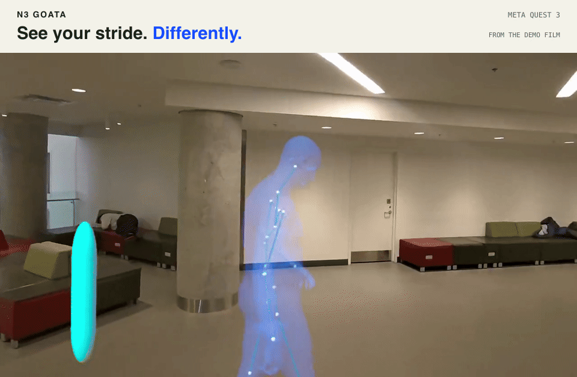
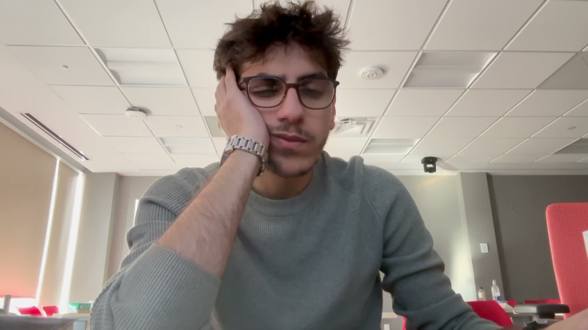

  

<h1 align="center">GOATA</h1>

Record a movement. Pause it in 3D. Walk around the moment.

  <a href="https://n3-goata.vercel.app/">Project website</a> ·
  <a href="#watch-the-demo">Watch the demo</a> ·
  <a href="docs/ENGINEERING.md">Engineering</a> ·
  <a href="docs/DEVELOPMENT.md">Developer guide</a> ·
  <a href="docs/STATUS.md">Project status</a>

<code>Hack the Hill III</code> · <code>Meta Quest 3</code> · <code>Unity + C#</code> · <code>Python + CUDA</code>

GOATA lets a practitioner record movement with Quest 3 and inspect a fitted body
and skeleton in mixed reality. Pause a movement, change the viewing angle, and
open the original recording at an observation's source moment.

The application and processing package use the name Physio Motion Replay.
GOATA is a research prototype. Its movement
estimates and demo scores are not validated clinical findings.

## Watch the demo

[Watch the full-quality film](https://n3-goata.vercel.app/#film) ·
[Open the video in this repo](docs/media/demo.mp4) ·
[View the static banner](docs/media/n3-goata-banner.svg)

The project film comes from the public Goata website. The banner uses its actual
Quest replay footage at 01:07.5 to 01:10.0, with the original room view intact.

## What you can explore

- **Capture with Quest.** Select a patient and test, confirm consent, and follow
  guided recording positions. Original recordings and timestamps remain intact.
- **Review a fitted body.** Inspect the translucent blue body and aligned
  skeleton. Pause, reverse, step through frames, change speed, or walk around it.
- **Follow the evidence.** Open a movement observation at its source moment.
  The practitioner chooses corrections.
- **Return to a saved test.** Keep dated patient histories, reopen saved results,
  and move or resize the replay without changing its stored measurements.

| Test | Movement reviewed |
|---|---|
| KERAAL ELK | Seated flank stretch. Estimated lateral torso lean. |
| KERAAL RTK | Seated torso rotation. Estimated shoulder-to-pelvis rotation. |
| Walking review | A full-body walking pass. Estimated knee flexion and torso inclination. |

The Goata Score combines deterministic demo rules into a score from 0 to 100.
The viewer shows the score and a summary. The current interface does not expose
the full calculation details. The score is not a clinical assessment.

Historical barefoot sessions remain readable. Walking review replaces barefoot
capture for new tests.

## How a recording becomes a replay

1. **Quest captures the source.** Unity and Meta's camera tools save the recording,
   its camera metadata, and the original frame timestamps.
2. **Python manages processing.** An authenticated FastAPI module validates uploads,
   preserves job state, and invokes the configured reconstruction command.
3. **Research models fit the motion.** Person tracking, ViTPose, HMR2, camera-motion
   estimation, and GVHMR produce a fitted SMPL-X body and joints on a CUDA GPU.
4. **Quest loads the result.** The exporter validates geometry and source mappings.
   The headset pairs replay controls with observations tied to the same take.

The [processing contract](docs/openapi.yaml) is the shared interface between the
Quest app and processing. [GPU setup](processing/reconstruction/GPU_SETUP.md)
documents the model environment separately from the local Python environment.

## Inference experiments

The [checked-in streaming experiment](experiments/streaming_inference/rtx3070-640-15.json)
uses an eight-second prerecorded input on an RTX 3070. With models already loaded,
it measures the time from input stopping to a decode-verified annotated video:

| Mode | Time after input stopped |
|---|---:|
| Start processing after input stops | 9.99 seconds |
| Process arriving chunks in sequence | 3.79 seconds |
| Process arriving chunks with camera-motion work on the CPU in parallel | 3.56 seconds |

Input arrives in four two-second chunks. These results exclude model startup,
Quest encoding, network transfer, and headset loading. The production processor
starts a command for each reconstruction and does not use the streaming runner.

The website's [2.27-second summary](docs/media/benchmark.json) describes a separate
run with half-second chunks. Its runner and raw event files are not included here.
The [engineering guide](docs/ENGINEERING.md#what-the-benchmark-measures) explains
the distinction.

## What is verified, and what remains

The [project status](docs/STATUS.md) lists implemented behavior and remaining
acceptance work. The code includes capture, saved patient history, reconstruction,
replay, and source-linked movement observations.

The remaining work includes:

- A fresh, timed capture-to-headset replay and full wearer acceptance. The whole-path
  target is one to two minutes after the last capture.
- Evaluated ELK and RTK findings and clinical gait assessment on unseen participants.
- A useful motion microscope result from a real Quest steady-hold recording.
  The microscope remains required and incomplete.

## Run and contribute

Read the [engineering guide](docs/ENGINEERING.md) for the implemented architecture,
module interfaces, data and coordinate mappings, job lifecycle, and verification
limits. Use the [developer guide](docs/DEVELOPMENT.md) for local processing,
configuration, request examples, and automated checks. Real reconstruction needs
the separate [GPU setup](processing/reconstruction/GPU_SETUP.md). An unconfigured
full-body reconstruction retains the recording and reports the failure. Historical
barefoot-only jobs can complete with unavailable analysis because they do not
require a replay.

| Path | What is inside |
|---|---|
| [`quest/`](quest/README.md) | Unity capture, patient history, spatial review, and device checks. |
| [`processing/`](processing/) | Uploads, persistent jobs, reconstruction, analysis, and replay export. |
| [`tests/`](tests/) | Backend, contract, and model-adapter checks. |
| [`experiments/`](experiments/) | Profiling and inference experiments, with their own evidence. |
| [`design/`](design/quest-menu/README.md) | Archived mockups and an unused navigation prototype. |
| [`docs/`](docs/) | Product requirements, implementation guides, status, and media sources. |

[Product specification](docs/SPEC.md) ·
[Engineering guide](docs/ENGINEERING.md) ·
[Quest build guide](quest/README.md) ·
[Project status](docs/STATUS.md) ·
[Media sources](docs/media/README.md)

## The team

| Builder | Focus |
|---|---|
| [Bader](https://github.com/B2707) | Backend and integration |
| [Mohammad](https://github.com/MohammadESteitieh) | Reconstruction and analysis |
| [Hamza](https://github.com/HamzaAlsarakbi) | Quest application |
| [Mustafa](https://github.com/mustafahelmyh) | Design |

Participant recordings, credentials, model weights, and restricted datasets stay
out of Git. The explicitly included public project film is presentation media.
Third-party models and assets retain their own terms, listed in the
[GPU guide](processing/reconstruction/GPU_SETUP.md#externally-mounted-assets-and-terms) and
[asset provenance files](quest/Assets/Physio/Art/).
