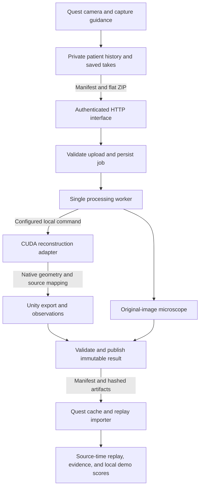

# Engineering guide

The implementation preserves recording identity and source time through model fitting and replay.
The fitted body supports inspection and geometric observations, without establishing clinical accuracy.

This guide explains the current source. [Development](DEVELOPMENT.md) has setup
and check commands. [The specification](SPEC.md) defines accepted requirements,
and [project status](STATUS.md) records completed checks and remaining device and GPU work.

## Data flow

Patient names stay on Quest. Processing receives opaque patient, session, and take IDs.
One take supplies the replay. Other viewpoints retain their own evidence identity.

## Modules and interfaces

The main interfaces are the capture contract, the configured inference command, and
the replay contract. Each keeps its validation next to the implementation that
accepts the data. No model checkpoint or Python object is an upload interface.

| Module | Interface and source |
|---|---|
| Capture | [QuestTakeRecorder](../quest/Assets/Physio/Capture/QuestTakeRecorder.cs) records camera images. [CaptureBundle](../quest/Assets/Physio/Capture/CaptureBundle.cs) creates the sidecar and sealed bundle. |
| Patient history | [LocalPatientStore](../quest/Assets/Physio/Workflow/LocalPatientStore.cs) owns patients, sessions, captures, and result versions. Its methods require matching patient and session identity. |
| Transfer | [ProcessingClient.ProcessAsync](../quest/Assets/Physio/Workflow/ProcessingClient.cs) handles submission, polling, download verification, and cache publication. [openapi.yaml](openapi.yaml) describes the HTTP interface. |
| Request handling | [create_app](../processing/service.py) wires authentication, upload validation, job storage, and one worker. An injected processor permits tests through the same HTTP interface. |
| Persistence | [Store](../processing/storage.py) owns admission, state transitions, recovery, and atomic result publication. |
| Processing | [Pipeline.__call__](../processing/pipeline.py) accepts saved inputs, capture and job context, an output directory, and a stage callback. It returns a result manifest. |
| Inference | [runtime.run](../processing/reconstruction/runtime.py) validates and prepares video. [gvhmr.infer_native](../processing/reconstruction/gvhmr.py) is the CUDA adapter. |
| Export | [export_native](../processing/export.py) validates native output and returns a replay manifest, artifact inventory, and provenance. |
| Publication | [validate_result](../processing/publication.py) checks identity, evidence, feature status, and output files before Store can publish them. |
| Playback | [ReplayImporter.Parse](../quest/Assets/Physio/Replay/ReplayImporter.cs) returns validated replay data. [ReplayClock](../quest/Assets/Physio/Replay/ReplayClock.cs) controls source-time playback. |

## Recording clocks and resampling

[QuestTakeRecorder](../quest/Assets/Physio/Capture/QuestTakeRecorder.cs) converts
the camera timestamp to Unix nanoseconds and journals frame IDs and capture state.
The encoder receives microseconds relative to the take's origin. Source
nanoseconds and encoded presentation timestamps remain separate fields.
[CaptureBundle](../quest/Assets/Physio/Capture/CaptureBundle.cs) records the media
mapping, missed frames, interruptions, camera metadata, and capture condition.

[runtime.bind_pts](../processing/reconstruction/runtime.py) checks every decoded
presentation timestamp against that media mapping. Equal frame counts alone do
not establish correspondence. The configured worker passes `--pts-offset-ns 0`
because this explicit mapping already binds the two clocks. The service requires
`sidecar.media`. The standalone runtime also supports legacy input with an
explicit decoder offset. That standalone option does not relax service validation.

GVHMR input uses the nearest original image at each 30 Hz target. Ties choose the
earlier image. [map_selected_frames](../processing/reconstruction/timing.py)
preserves the original frame ID, timestamp, and elapsed source time for every
selection, including repetitions. `inference_time_s` is a model input time,
not a replacement for the source clock.

The runtime rejects interrupted takes, invalid images, declared gaps, and source
intervals above 100 ms. It accepts at most 3,600 source frames and 600 prepared
inference frames. It does not trim a longer take automatically. Inference also
requires one consistent person track in every prepared frame.

## Model execution and the CPU and CUDA execution

[Pipeline](../processing/pipeline.py) launches the configured JSON argument list
as a fresh local subprocess for each replay take, without a shell. Models do not
remain loaded between production jobs. It adds video, sidecar, output, and timing
arguments, adds the repository to `PYTHONPATH`, and removes `PROCESSING_TOKEN` from
the child environment. A container adapter must map those paths itself.

The [GPU adapter](../processing/reconstruction/gvhmr.py) checks the pinned GVHMR
revision and required asset files, then runs this chain:

1. YOLO tracking selects one person and produces crop boxes.
2. ViTPose produces 17 image keypoints, and HMR2 produces image features.
3. SimpleVO uses SIFT and pycolmap to estimate camera rotations. Rotations between
   sampled images are interpolated estimates. A missing relative pose fails the
   take instead of silently assuming a static camera.
4. GVHMR predicts global and camera-relative body parameters with `static_cam=False`.
5. SMPL-X evaluates global parameters to produce body vertices and the first
   22 posed kinematic joints from the same body-model call.

[native.prepare](../processing/reconstruction/native.py) validates finite JSON
parameter arrays, camera matrices, and source selections. It does not run a model
or create geometry. CUDA imports remain inside the adapter, so CPU tests can check
contracts, timing, orchestration, and export without importing torch.

The GPU environment requires CUDA and registered body assets, separately from
the Python 3.11 service environment. [GPU setup](../processing/reconstruction/GPU_SETUP.md)
records the pinned environment and proof history. Mac CPU checks do not prove GPU execution.

## Native output and Unity conversion

The native handoff includes the input video and sidecar hashes, model revision, asset
hashes, selection mapping, geometry metadata, and a fixed artifact inventory.
Coordinates are little-endian float32 XYZ arrays. Triangles are uint32 triples.
The [exporter](../processing/export.py) verifies sizes, hashes, finite coordinates,
topology, source identity, and decoder binding before conversion.

Native geometry uses right-handed `gvhmr_global_ay` coordinates with Y up. Export
applies `(x, y, z) -> (x, y, -z)` to both the mesh and joints and reverses triangle
winding. Root translation survives. There is no per-frame recentering, pose
interpolation, physical rescaling, or Quest-world registration.

Repeated selections retain the first inference row for each unique original
frame in the display replay. The full inference-to-source mapping remains in
`resampling_map` and provenance. Mesh, skeleton, validity, and time arrays use the
same selected rows. The exporter does not average repeated predictions.

`fitted_valid.u8` means a finite model estimate, not observed anatomy or calibrated
confidence. Replay `joint_valid` preserves that distinction. Model metres remain
labelled `scale_status: estimated`. Hands, face, and expression use body-model
defaults and are not measurements.

[ReplayImporter](../quest/Assets/Physio/Replay/ReplayImporter.cs) independently checks
hashes, counts, finite values, topology, coordinates, and the decoded allocation budget.

## Job storage, retries, and failure

[create_app](../processing/service.py) admits one upload validation at a time and
uses one worker thread. [Store](../processing/storage.py) allows one active job.
`pending` is persisted state for that slot, not an unbounded queue. A filesystem
lock prevents two processes from opening the same store.

Jobs move from `pending` to `running` to `succeeded`, or to `failed` on error.
Stages identify preparation, estimation, analysis, and export without invented
percentage progress. Busy or full storage produces a retryable 429 response.

[Upload validation](../processing/uploads.py) computes a digest over canonical
manifest JSON and the sorted, verified member references. The same idempotency
key and digest returns the original job. Reusing the key for different content
returns 409. Deliberate reprocessing uses a new key and creates another result.

Accepted input files and state are flushed before acceptance completes. Output
stays in `output.tmp` until [publication validation](../processing/publication.py)
passes. Store flushes files, renames the artifact directory, then records success.
On restart, unfinished jobs become `WORKER_INTERRUPTED`. Partial outputs are
discarded, while accepted recordings and successful results remain available.

When a job requests a replay but inference is unconfigured, it fails with
`PROCESSING_FAILED` and retains the capture. A historical barefoot job without
a replay skips reconstruction and can publish a result with unavailable foot
assessment. Neither path generates substitute motion. Result and artifact routes return
409 until a job succeeds. Downloads resolve opaque artifact IDs through that
job's inventory, not through caller-supplied file paths.

On Quest, [ProcessingClient](../quest/Assets/Physio/Workflow/ProcessingClient.cs) resumes
saved jobs and verifies downloads before publishing a cache directory.
[LocalPatientStore](../quest/Assets/Physio/Workflow/LocalPatientStore.cs) preserves
immutable captures and dated results. Reopening a result does not rerun inference.

## Replay time and evidence

[ReplayClock](../quest/Assets/Physio/Replay/ReplayClock.cs) returns a new clock
state for play, pause, seek, reverse, frame step, or speed changes. Speeds are
0.25, 0.5, 1, 1.5, and 2. Playback stops at either endpoint. Seek and frame step
pause playback. Speed changes affect the cursor, not stored measurements.

[ReplayTimeline](../quest/Assets/Physio/Replay/ReplayTimeline.cs) holds the original
sample at or before the cursor. It does not invent motion between samples and
does not treat a hold across a declared gap as observed evidence. The renderer
uses the same sample index for body and skeleton and respects joint validity.

Selecting matching-take evidence pauses and seeks to its start. Selecting
other-take evidence pauses the body at its current position. Only matching-take
evidence can highlight the replay. [ReviewEvidence.CanSeek](../quest/Assets/Physio/Viewer/ReviewEvidence.cs)
checks identity explicitly. Equal elapsed times in different performances do not
identify the same movement.

## Observations, demo scores, and findings

[Pose observations](../processing/analysis/observations.py) measure the original
exported joints. ELK reports signed lateral torso lean. RTK reports the unsigned
shoulder-to-pelvis rotation. Walking reports each knee's bending and trunk
inclination. Each peak retains source take, frame, and time. Invalid or degenerate
samples remain unavailable rather than becoming zero-valued measurements.

[MotionPatternClassifier](../quest/Assets/Physio/Replay/MotionPatternClassifier.cs)
adds local descriptive summaries from saved replay data. It requires at least
two eligible samples and keeps the first source frame when peaks tie. Knee
comparisons use frames where both legs support the comparison, while retaining
each peak's separate evidence moment.

[GoataScore](../quest/Assets/Physio/Replay/GoataScore.cs) implements `goata-demo-v1`.
It computes `100 - sum(weight * severity)` with linear, capped demo deductions.
The two default weights are 50 each. Walking uses knee peak difference with a 20-degree
scale and upper-body tilt with a 30-degree scale. ELK uses shoulder-to-hip twist and
fore-and-aft tilt. RTK uses sideways and fore-and-aft tilt, each with a 30-degree scale.
Available categories are reweighted to total 100. No supported category means
an unavailable score. These thresholds are app-defined demonstration rules.

`GoataScoreResult.Details` contains the deduction explanation, but the viewer
currently shows only `Score` and `Summary`. Observation details have a separate
UI path through `InsightPresentation.Details`. The score explanation is not yet
connected to that path.

The [pipeline](../processing/pipeline.py) still returns `findings: []` and
`validation_status: research_demo_unvalidated`. Evaluated ELK and RTK assessment,
clinical gait assessment, and automated historical foot assessment remain
unavailable. A score or descriptive observation does not change that status.

The [microscope module](../processing/microscope.py) works on original video,
checks sampling and background stability, and returns original and amplified artifacts
or an explicit unavailable result. Numerical pose analysis never uses amplified
images or display-scaled geometry. Magnification can also amplify artifacts.

## Security and resource limits

[Authentication](../processing/service.py) checks one bearer header with a
constant-time comparison before parsing request bodies. The [CLI](../processing/__main__.py)
requires TLS outside loopback. One deployment token grants access to that
deployment's jobs. It is not multi-clinic authorization. HTTP and worker handlers
log request or job IDs without arbitrary exception text. In contrast,
`process_microscope` uses `logger.exception` for decoder and artifact-write
failures. That path writes a stack trace, so the code does not guarantee sanitized
logs throughout the service. Inference stdout and stderr go to `DEVNULL`.

[Upload validation](../processing/uploads.py) rejects traversal, linked or
unlisted members, duplicate names, malformed archives, and mismatched hashes.
It accepts bounded flat ZIPs, not arbitrary remote URLs, executables, or pickle
files. Decoder checks establish media and time correspondence after signature checks.

[Settings](../processing/settings.py) bound ZIP uploads to 512 MiB, expanded
files to 1 GiB, and private storage to 8 GiB by default. Uploads have a 120-second
deadline. Inference has a 900-second deadline and 768 MiB scratch budget. Timeout
handling kills the inference process group. The decoded replay limit is 256 MiB.
[Development](DEVELOPMENT.md) lists the complete upload and output limits and options.

## What the benchmark measures

The [published benchmark](media/benchmark.json) describes a local public-video
experiment. Original processing took 119.97 seconds after complete input was
accepted. The warmed streaming run took a median 2.27 seconds after simulated
capture ended, or 10.27 seconds from capture start to decode-verified annotated
video. The clocks start at different points and the outputs are not Quest display.

The published record describes 640 by 360 analysis, 15 observations per second,
half-second input chunks, and mixed precision. Its raw runner and event files
are absent from this repository. The checked-in
[streaming fixture](../experiments/streaming_inference/fixture.py) instead requires
four two-second chunks. Its [RTX 3070 result](../experiments/streaming_inference/rtx3070-640-15.json)
records 3.5604 seconds from stop to decode-verified video for the CPU-overlap
streaming run. Serial streaming took 3.7902 seconds. Both experiment records exclude
Quest encoding, network transfer, headset loading and display, and one-time warmup.
The [persistent](../experiments/persistent_inference/)
and [streaming](../experiments/streaming_inference/) experiments are separate from
the production Pipeline, which launches a fresh command for each reconstruction.
These measurements do not prove a two-second capture-to-headset replay.

## Verification coverage and open checks

[Python tests](../tests/) cover uploads, persistence and restart recovery, publication,
coordinates, media timing, and observations. Live HTTP tests use a real loopback
listener with synthetic input and a test-only processor. [pyproject.toml](../pyproject.toml)
sets an 80% coverage threshold for processing, not a model-accuracy threshold.

[Quest checks](../quest/Checks/) exercise importer rejection, replay timing,
capture metadata, workflow identity, evidence, patterns, and Goata scoring.
[The Quest guide](../quest/README.md#run-checks) separates these checks from
Unity builds and device work. [Development](DEVELOPMENT.md#run-the-automated-checks) contains
the Python check entrypoints.

Remaining acceptance includes a fresh timed capture-to-headset run, wearer input
and visual alignment checks, useful real steady-hold microscope output, and
assessment evaluation on unseen participants. Historical installation, synthetic
encoder checks, and public-video GPU proofs do not complete those checks.
