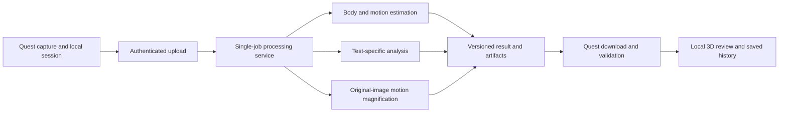

# Physio Motion Replay — complete implementation specification

- **Version:** 1.0, September 26, 2026.
- **State:** accepted product decisions and proposed engineering design; implementation is not yet verified.
- **Target:** Meta Quest 3, with desktop/server processing.
- **Original deadline:** September 27, 2026, 10:00 a.m. EDT / 14:00 UTC.
- **Repository:** https://github.com/B2707/HTH-3-sarakbi-asadi-steitieh-grp

This is the source of truth for a new Codex session. `HANDOFF.md` records what actually works. `openapi.yaml` defines the proposed service interface. No conversation history is required. Where a model, measurement or runtime remains unverified, that is an explicit engineering task, not permission to invent a result.

## 1. Product and success

A practitioner records a consenting participant performing a supported test. Quest guides the practitioner through suitable camera positions. Processing then produces an animated, light-blue translucent representation of the participant, an aligned estimated skeleton and labelled findings tied to the recording.

The practitioner can pause the participant in mid-movement, physically walk around the body, select a finding, inspect evidence and replay that interval slowly or backward. Patient profiles retain previous tests.

The visual effect should be impressive because the movement and findings come from the captured participant. The blue surface is an estimated body model used for presentation; exact facial features, clothing colour, hair and clothing folds are not required.

### Completion means

- A fresh team recording follows capture → processing → saved result → Quest review.
- Findings are derived from that recording and identify their source evidence.
- A patient-fitted body and skeleton stay aligned while the reviewer changes viewpoint and playback.
- The user can reopen the saved test after restarting the application.
- Each of the three tests and the motion microscope has its own demonstrated outcome and validation record.
- Missed requirements remain explicitly incomplete. A fallback demonstration does not establish feature completion.

### Latency and responsiveness

**Agreed product target:** 1–2 minutes from the end of the last required capture to the completed findings and first loaded replay frame. Include preparation, transfer, model work, analysis, export, download and loading. This is not a measured capability yet.

**Initial engineering targets:** sustain 72 Hz when reviewing on Quest; seek feedback within 250 ms after the replay is loaded. These are starting targets to measure on-device. Head tracking remains responsive while replay is paused, slowed or reversed. Cloud processing must never run again merely because the wearer turns their head.

## 2. Locked scope

| Requirement | Decision and reason |
|---|---|
| Device/operator | Practitioner wears Quest 3; participant performs the test. |
| Tests | Exactly three: seated flank stretch (KERAAL ELK), seated torso rotation (KERAAL RTK), barefoot assessment. Limits the protocol/model work. |
| Capture | Live instructions and quality guidance; completed findings after all required captures. |
| Human appearance | Fitted translucent blue surface; recognizable body proportions matter, face/clothing texture does not. |
| Replay | True animated 3D geometry viewed from any headset position. A floating 2D video does not replace it. |
| Skeleton | Same fitted motion as the body, or an explicitly verified mapping. |
| Controls | Play/pause, seek, reverse, restart, frame steps, 0.25×/0.5×/1×/1.5×/2× speed. |
| Manipulation | Reposition, rotate and resize the body; measurements retain original values. |
| Patients | Multiple local profiles with dated histories and saved results. |
| Findings | Test-specific labels, explanation, body region/side, source interval and evidence. Practitioner decides corrections. |
| Microscope | Contextual Magnify motion action with labelled original/amplified images. Required. |
| Feet | Dedicated barefoot method and close-up workflow. Required; its supported metric still needs evidence. |
| UI | Meta UI Set, readable bounded panels and standard hand/controller behaviour. |
| Voice | Optional after all required capabilities and rehearsal work. |

### Excluded

Arbitrary exercise recognition, unrestricted walking analysis, external face identification, TMR sensing, new sensing hardware, photorealistic reconstruction, live reconstructed humans during capture, automatic treatment/correction advice, production clinic accounts/integrations and a general-purpose voice assistant.

Earlier discussions of sound stealing, magnetic sensing, object cloning and security overlays were alternative projects. Do not combine them into this application. Gaussian-splat and detailed-avatar research is deferred because the accepted blue-body appearance does not require it.

## 3. Roles, patient history and screens

No production login system is needed for the team demo. The practitioner selects a local patient profile; display name is sufficient. Generate stable UUIDs independent of names. Two patients can have the same display name without sharing results.

Navigation:

**Patients → Patient history → New test / Saved test → Capture → Processing → Findings and replay**

| Screen | Required content and actions |
|---|---|
| Patients | Existing profiles; New patient with system keyboard; select profile. |
| Patient history | Patient name, dated tests, test type/status, open saved test, New test, Back. |
| Test selection | Only the three named choices; short protocol explanation. |
| Capture | Exercise/view instructions, framing guidance, countdown, Record/Stop, captured/missing/retake states. |
| Processing | Actual stage, elapsed time, useful failure/retry state. Keep the recording. |
| Review | Patient/test/date, body and skeleton when available, relevant finding list, playback row, Options. |
| Finding detail | One expanded finding, highlighted region, evidence action and Magnify motion where applicable. |
| Microscope | Original and amplified recording region, matching interval, explicit labels, Back to analysis. |

Opening history restores the saved result version. Reprocessing creates another version instead of silently changing what a practitioner saw previously. Never overwrite original media on retry.

## 4. Capture protocols

### 4.1 Shared capture flow

1. Select the patient and test before recording.
2. Show the exact protocol, demonstration/reference and required views for that test.
3. Request camera access with a useful explanation; handle denial visibly.
4. Confirm the intended participant and needed region are visible.
5. Guide the headset wearer to the first position. Give a countdown and record a complete repetition.
6. Keep the camera approximately steady during the repetition; move to the next position between takes.
7. Preserve separate take IDs, view, side, condition and recording times.
8. Ask for a retake when the relevant region leaves frame or required evidence is missing.
9. Save the capture locally before submission. Processing starts after the required captures finish.

Prefer the minimum number of views that the tested method needs. Prototype with a front take and side take, then fix the actual required view list from the protocol and model test. Do not advertise a rear view as measured when it was inferred. Avoid hard-coding an arbitrary distance before testing framing on Quest.

### 4.2 Seated flank stretch — `elk`

Use the actual KERAAL ELK protocol. It is a seated rehabilitation exercise, not a generic standing side-bend assessment. Provide a suitable chair and frame the relevant torso, arms, pelvis and chair context.

Inspect the released annotation guide before building labels. Its categories concern resting-arm position, extent of side bend and composite compensation errors involving leaving the seat/bending too far. This summary is not the final machine label mapping. Copy exact IDs and definitions into a versioned protocol file, including what the chosen input can actually observe.

Do not invent angle thresholds from the exercise name. A model must support an error class before the interface can show that class as a finding.

### 4.3 Seated torso rotation — `rtk`

Use the KERAAL RTK protocol and its own required framing. The annotation guide covers arm position, extent of rotation and composite compensations involving leaving the seat/sideways leaning. Keep its categories separate from ELK even where they share body regions.

Assess whether the camera/model can observe each required movement. A fitted torso segment is not a direct measurement of individual lumbar vertebrae or chair contact.

### 4.4 Barefoot assessment — `barefoot`

Record left/right identity, the capture view, standing/seated condition and any calibration. Guide barefoot close-ups, including the view required by the selected foot method. The method determines exact framing and metrics; a plausible-looking foot reconstruction is not evidence of arch condition.

Full-body estimation stops accepting results during close-ups. Review opens the foot evidence and its findings. If a body reference is available, it must come from an explicitly identified full-body take for that same patient; show its source time and keep the foot result attached to its own capture condition.

**Unresolved implementation requirement:** select an obtainable, appropriately evaluated foot measurement/classification method. A standard body pose tracker provides no arch landmark. No validated ready-to-run Quest flat-foot classifier has been established. Capture-only functionality does not complete this feature.

### 4.5 Guided multiple views

Repeated movements from different viewpoints are separate performances, not synchronized multi-camera footage. Choose one source take for replay and event timing. Other views may help check shape or compare observations; combining shape is optional until verified. Never average repetitions into a motion that conceals actual differences.

### 4.6 Capture quality and interruptions

Store quality per frame/region. Missing poses are invalid, not coordinates at zero. Do not make up hidden joints as observations. Explain which view/region needs recapture.

If system UI interrupts recording, preserve the completed frames and mark the take interrupted. Do not silently concatenate across the interruption. A user can keep an incomplete take for inspection or retake it; only complete eligible takes feed the required assessment.

## 5. Quest implementation and UI

### 5.1 Supported development route

Use Unity/C#, Unity OpenXR Plugin, Meta XR Core SDK and Meta XR Interaction SDK. Add the Passthrough Building Block. Use MRUK's documented camera-access components and samples for computer vision; ordinary passthrough display does not itself supply camera frames.

Start from official samples, not a new XR interaction framework. Confirm a compatible Unity/editor/package combination on the actual headset and commit the resulting manifests/lockfiles. No exact editor/SDK version has been validated yet.

macOS can build an Android APK when Unity Android Build Support, SDK/NDK and OpenJDK are installed. Enable developer mode and authorize USB debugging, then use Build And Run or ADB. Quest Link editor streaming requires Windows. This is an immersive app with its own mixed-reality UI, not a system-wide overlay on other apps.

### 5.2 Standard Meta interface

Use Meta Horizon OS UI Set through Interaction SDK Essentials. Start with `UISetPatterns` or `UISetExamples`; preserve its backplates, themes and interaction feedback. Use supplied buttons, sliders, toggles, dropdowns, text inputs and dialogs. Enable the system keyboard for patient names.

One main movable panel contains navigation and details. Place it beside the blue body. Use a visible Back action, patient/test context and an Options button. Keep one finding expanded. Keep text readable against both bright and dark passthrough backgrounds.

Use the supplied ray/poke canvas integration and hand/controller rig. C# application methods respond to UI events; do not reimplement pointer targeting or gesture recognition. Keep hand and controller paths equivalent for required controls.

Initial panel placement is approximately one metre away for indirect interaction; allow repositioning. Follow current Meta guidance for near touch versus ray use, angular target size, spacing and reach, then test on-device. Do not treat browser CSS pixels as spatial measurements. Keep layout stable during hover. Navigation, recording controls and replay must work seated with one controller or one hand; obtaining other capture viewpoints remains part of the protocol.

### 5.3 Options menu

- Resume / Close options.
- Display: body opacity, skeleton visibility, finding-label visibility.
- Placement: Bring panel here; separately Reset replay placement.
- Controls: brief manipulation and playback help.
- Patient history: return to this patient's tests.

Use the left-controller Menu button and visible Options action. Support the SDK's standard hand-menu route without consuming reserved system gestures. The Meta button remains system-owned. Bringing the panel closer never moves the replay or changes calibration.

When the app loses input focus, ignore app input, hide app hand/controller visuals and continue rendering as required by Meta. Pause the replay clock, preserve its position and explicitly mark capture interruption. Returning focus restores the review state.

### 5.4 Playback row and interaction

Expose Play/Pause, a generous seek slider, Reverse, speed selection, previous/next frame and Restart. Reverse changes direction independently of speed; the initial behaviour stops at either clip endpoint. Display the actual source time.

Selecting a finding from the replay's source take seeks to its interval and highlights the region with a label and shape/line cue, not colour alone. A finding from another take opens its own labelled evidence while the hologram stays paused; display that it belongs to a separate recording. Equal timestamps in different repetitions do not identify the same movement. Manipulation applies a common parent transform to body, skeleton and attached labels. Provide reset and labelled controls as alternatives to complex gestures.

## 6. Architecture and runtime responsibilities



### Quest owns

Patient display names/history, capture guidance and files, submission/retry state, validated result cache, replay clock, rendering, interaction and saved-session reopening.

### Processing service owns

Input validation, recorded job states, model execution, test-specific analysis, evidence provenance, export and authenticated artifact delivery. Use Python/FastAPI for the thin service and existing model scripts behind it. A long-running model runs outside the request handler. Start with one active GPU job; reject excess work with a retryable response. Do not add a distributed queue for this demo.

### Storage and deployment

Use application-private Quest storage for local sessions and a configured private service directory for job files. Save metadata atomically and keep result versions immutable. A single service process with a lock is sufficient; record its one-worker limit and revisit only if simultaneous users become a requirement.

Remote compute must have explicit access/cost authorization. The repository request does not authorize paid jobs or participant upload. Verify how Quest reaches the service over the actual network. Use TLS for remote access and a deployment token entered/configured at runtime; never compile a secret into the app or put it in Git. Do not expose an unauthenticated public GPU endpoint.

## 7. Models, analysis and evidence

### 7.1 Body/motion reconstruction

**First candidate: GVHMR with its fitted SMPL-family output.** Run one real short clip through the released workflow on compatible NVIDIA compute before training or polishing UI. Record code revision, dependency versions, assets, device/GPU, memory use and duration.

The inspected release specifies Python 3.10, PyTorch 2.3.0/CUDA 12.1 and a Linux x86-64 PyTorch3D dependency. Treat these as upstream starting requirements, not a verified local environment. It requires registered SMPL and SMPL-X assets plus pretrained checkpoints. Start with pretrained inference; retraining the body estimator is outside this demo. Do not assume it runs unchanged on an Apple GPU or that source-code availability grants rights to every weight/exported asset.

**Timing trap:** the inspected demo re-encodes inputs at a fixed 30 FPS. Preserve original Quest presentation timestamps. Either explicitly resample inference input to 30 FPS with a source-frame/time mapping, or adapt the pipeline to retain supported timing. Never report `frame_index / 30` as observed timing unless the input was truly mapped that way.

**Calibration trap:** the stock demo may estimate camera intrinsics. Check the path that consumes actual camera calibration; log when estimates are used. Validate the exported coordinate frame and metric scale instead of assuming model output equals measured world geometry.

Trying to stand still does not make a head-worn camera static. Validate the camera-motion path; do not set a static-camera shortcut merely because the wearer receives a steady-capture instruction. Export geometry/joints before optional preview-video rendering to avoid unnecessary work in the timed path.

For the first viewer, export fixed mesh topology and per-frame vertices/joints. This avoids depending on a new rig-retargeting or Gaussian-sequence renderer. The body surface and displayed skeleton should come from the same fitted body sequence. Preserve root movement so stepping/sway is not erased.

### 7.2 KERAAL exercise analysis

KERAAL provides recordings, skeleton sequences and expert annotations. It does not establish a working Quest classifier. Inspect the actual download, annotation granularity, exercise IDs, participant IDs and licenses before implementing training.

The documented groups differ: 1A/2A have temporal/body-part error annotations, 1B/2B are unlabelled, and Group 3 includes simulated-error recordings. Group names are not an automatic train/test split. Code is BSD-2-Clause; the dataset has separate CC-BY-NC-SA terms. Verify the downloaded release's terms before use.

The released LSTM is example training code with processed Kinect inputs and whole-sequence labels, not pretrained ELK/RTK detection for Quest. Do not run its example configuration unchanged and claim temporal findings.

Implementation sequence:

1. Obtain authorized data and inspect ELK/RTK examples and their annotation definitions.
2. Build a label inventory with source code, meaning, body region, temporal granularity, exercise and observable inputs.
3. Select only categories that can be learned and checked from the chosen inputs. Report remaining categories as unsupported.
4. Prefer compatible released baselines. If they cannot produce the required labelled findings, train the smallest suitable supervised classifier on timestamped pose-derived features. A new CNN is not a prerequisite; the chosen baseline must be justified by held-out results.
5. Prefer extracting training and live features with the same tracker. If using KERAAL skeletons directly, document/test the joint and coordinate mapping instead of passing mismatched landmarks into the model.
6. Split by participant before fitting normalization, thresholds or parameters. Keep evaluation participants out of training/tuning. Do not use neighboring frames from the same person as an independent test set.
7. Evaluate each supported category and temporal localisation where annotations support it. Record counts, false positives/negatives, class imbalance and failures; then test fresh teammate recordings.
8. Freeze the model and preprocessing version used by the demo and save it with results.

Begin with one observable, sufficiently represented error category per exercise. That is enough to prove two distinct exercise analyses; expand only after the first categories work. Save the participant split, label dictionary and feature version. Report held-out confusion counts, per-class precision/recall, false positives on correct repetitions and temporal overlap where valid temporal labels exist.

If only clip-level annotations are available for a category, do not invent frame-level onset/offset ground truth. If predictions are window-based, retain their actual window/source times. A model score is not automatically a calibrated probability of correctness.

The precise baseline and category list are gated on data inspection. The required behaviour is genuine exercise-specific findings with evidence. A scripted label or random score cannot satisfy it. Do not label a fitted spine animation as measured vertebral pathology.

### 7.3 Foot analysis

Select a method whose documented input conditions and output match what we can capture. A photographic arch measurement may need controlled view, visible anatomical points and scale; a classifier needs obtainable weights/data and suitable evaluation. Review licensing and input compatibility before integration.

For the chosen method, record the exact output, required views, units/calibration, reference comparison and known failure conditions. Test it against appropriate reference measurements or labels. A static standing result stays labelled standing; it is not a statement about arch behaviour during walking or a torso exercise.

If a usable method cannot be established, mark the automated foot feature incomplete and explain the blocker. Preserve its capture/evidence workflow, but do not count that fallback as completed analysis or silently remove the requirement.

### 7.4 Findings and feedback

Each automated finding contains:

- stable ID, session/result version and test-specific label code;
- readable label and explanation;
- body region/side where applicable;
- source take, frame references and actual interval;
- measured/estimated values with units and scale provenance where supported;
- evidence artifact references and quality/limitations;
- method/model/preprocessing version.

**Accepted feedback choice:** show the issue, explanation and evidence; the physio decides the correction. Do not generate next-repetition correction instructions or treatment recommendations. Instructions for performing/capturing the selected test are still required.

Practitioner-written notes, if added, must remain visibly distinct from automatic findings. Do not introduce a general chat model to invent measurements or explain an unsupported error class. Deterministic text for supported labels is sufficient.

### 7.5 Motion microscope

Operate on original camera footage before pose fitting or smoothing. A smooth skeleton cannot recover subtle image motion that the tracker discarded.

Flow: select finding or recorded region → Magnify motion → original/amplified comparison → Back to analysis. A suitable region can open the microscope even when no automated finding exists. Keep both views at the same source interval. Clearly label amplification and retain its settings and method version.

Use a compatible existing motion-magnification implementation; the MIT work is the reference principle, not proof that this headset capture will work. Require a sufficiently steady segment and check camera-motion compensation. Amplify a stationary/background reference as a negative control: if global shake dominates, return insufficient capture.

Magnification supports visual inspection. Compute numerical movement values from unamplified evidence. The microscope does not alter the stored skeleton, findings or body animation. A panel showing enlarged video without useful temporal amplification is not completion of this feature.

## 8. Data, timing and coordinate contracts

### 8.1 Local records

| Record | Minimum contents |
|---|---|
| Patient | UUID and display name. |
| Test session | UUID, patient UUID, test/protocol version, UTC date, status and take/result references. |
| Take | UUID, view, side, condition, media, timing/calibration metadata, quality and interruption state. |
| Result version | UUID, session/job UUIDs, source takes, creation time, model/code/settings versions, artifact inventory and feature availability. |
| Finding | Label, explanation, source interval/frames, body region, values, evidence and limitations. |
| Microscope result | Original/amplified media, source region/interval, method/settings and quality state. |

Use `elk`, `rtk`, `barefoot` as stable machine test IDs. Display names are separate. No patient names are needed by the processing service. Save results under the session's patient UUID, not whichever profile happens to be selected when a download finishes.

### 8.2 Capture bundle

`openapi.yaml` defines the upload manifest. Submit a flat ZIP with UUID-based filenames for video and JSON metadata. Each declared member has a byte count and SHA-256 digest. No nested paths or executable content are needed.

Each take's metadata sidecar uses a versioned JSON document containing:

- `schema_version`, `take_id`, capture-adapter/version and video dimensions/orientation;
- camera identifier and calibrated intrinsics for the recorded image size, or explicit unavailable/estimated status;
- distortion/crop/rotation conventions applied by the adapter;
- ordered frames with `frame_id`, original presentation timestamp, source clock identity and validity;
- image-time camera pose when available, its tracking validity and documented coordinate convention;
- any pose-to-image timestamp offset or alignment method when exact synchronization is unavailable;
- capture condition, view/side and interruptions.

Store nanosecond timestamps as decimal strings if used in JSON, avoiding integer precision loss. Store playback offsets separately as seconds from the first original source frame. Do not assume video frame count divided by nominal FPS recovers irregular capture timing. Calibration must match any resized/cropped inference image.

Freeze these sidecar field names before separate capture/processing work starts:

| Field | Type and meaning |
|---|---|
| `schema_version`, `take_id` | String `1.0` and UUID matching the upload take. |
| `adapter` | Object with `name` and `version` strings. |
| `image` | Positive integer `width_px`, `height_px`; `rotation_degrees` in 0/90/180/270; boolean `mirrored`. |
| `camera` | `id`, `calibration_status` (calibrated/estimated/unavailable), optional `intrinsics` (`fx`, `fy`, `cx`, `cy` in pixels), `distortion_model` and `distortion_coefficients`; document any crop. |
| `clock` | `id` identifies the source monotonic/PTS clock; `unit` is `nanoseconds`; `origin_pts_ns` is a decimal string. |
| `frames` | Ordered array of nonnegative unique integer `frame_id`, decimal-string `pts_ns`, boolean `image_valid`, and optional `camera_pose`. |
| `camera_pose` | When supplied: `position_m` XYZ, `rotation_xyzw` quaternion, `coordinate_system`, decimal-string `pose_time_ns`, `tracking_valid` and `alignment_method`. The adapter documents the relation to image time. |
| `capture` | `view`, `condition`, `side` matching the take; boolean `interrupted` and any explicit gap intervals. |

If calibration or poses are unavailable, record that state and omit the unavailable numbers. Validate intrinsics as finite with positive focal lengths and require monotonic source times. Original frames may be rejected downstream without renumbering them. After inference resampling, retain a separate map to the original frames/times; a resampled frame ID never replaces a source ID.

### 8.3 Replay package, version 1

Use one fixed-topology surface with aligned vertex/joint frames. The following is a proposed exporter/importer contract to prove in milestone M1; do not build two animation formats at once.

| Artifact | Encoding |
|---|---|
| `replay_manifest.json` | UTF-8 JSON with metadata, counts, timing, quality and artifact IDs. |
| `mesh_triangles.u32` | Little-endian uint32 indices, groups of three, fixed for the clip. |
| `mesh_vertices.f32` | Little-endian float32, frame-major then vertex-major XYZ. |
| `skeleton_joints.f32` | Little-endian float32, frame-major then joint-major XYZ. |

The replay manifest declares:

- schema/result/source-take IDs and exact fitted model/topology revision;
- frame count, vertex count, triangle count and joint count;
- joint names and parent indices, with a documented mapping to finding regions;
- strictly increasing `frame_times_s` and matching `source_frame_ids`;
- per-frame/per-joint validity or quality masks; gaps are explicit;
- each binary artifact's UUID, byte length, SHA-256 and encoding;
- `coordinate_system: unity_left_handed_y_up_z_forward`, `units: metres`;
- `scale_status: calibrated | estimated`, calibration/source provenance;
- the source-to-replay transform and any inference resampling mapping.

Exporter converts model output once into a take-local frame with +X right, +Y up, +Z forward. Verify handedness with a known asymmetric movement and axis fixture. Convert triangle winding/normals consistently. Root position changes remain in the sequence. An estimated metre scale must be visibly labelled estimated and must not become a measured height/arch dimension.

On import, validate counts, integer multiplication bounds, file sizes, index ranges, timestamp order, finite values and joint parents before allocation/rendering. Expected vertex bytes are `frame_count * vertex_count * 3 * 4`; joint bytes use joint count. Initial maximum decoded replay budget is 256 MiB, an input ceiling to tune after measurements, not a performance promise.

Zero-filled invalid slots are never observations. Do not interpolate across missing segments as if measured; show a gap or mark the display interpolation explicitly. Analysis retains its own original samples and validity. Display downsampling, if needed, must retain source times and cannot replace analysis data.

### 8.4 One playback clock

State: clip, source-time cursor, playing flag, positive speed multiplier and direction (+1/-1). Advance only the source-time cursor by real elapsed time × speed × direction. Clamp at endpoints and stop. Seek sets the cursor directly. Frame steps select adjacent source times.

Surface, joints and matching-take finding interval state derive from that same cursor. A finding or microscope interval may drive the 3D cursor only if its `take_id` matches `replay.source_take_id`. Other-take evidence uses its own labelled video timeline and leaves the body paused with temporal highlighting inactive. Headset view pose updates independently. A paused body remains at its selected room location when the practitioner moves.

A display parent transform handles placement/rotation/scale. Keep it separate from calibrated source coordinates. Changing display scale or speed never rewrites recorded metrics. Interpolation may improve presentation only over eligible intervals; frame-step and evidence views must still expose the source samples.

## 9. Service API, persistence and failures

The authoritative proposed HTTP schemas are in `openapi.yaml`. Validate them in both server tests and a client fixture before implementing independent assumptions.

| Operation | Purpose |
|---|---|
| `POST /v1/jobs` | Authenticated multipart upload of manifest and media; return persisted job ID. |
| `GET /v1/jobs/{job_id}` | Poll persisted state and actual stage. |
| `GET /v1/jobs/{job_id}/result` | Fetch completed result manifest. |
| `GET /v1/jobs/{job_id}/artifacts/{artifact_id}` | Fetch an artifact from that job's allowlisted inventory. |

Proposed states are pending, running, succeeded and failed. UI stages map to preparing recording, estimating movement, analysing test and preparing replay. Poll according to the server's `Retry-After` header, initially two seconds, and back off on network/server failures. No invented percentages.

Use a UUID idempotency key for submission. Retrying the same submission must return the same job when its content matches. Reusing a key with different content returns a conflict. A deliberate new processing attempt gets a new key/result version while keeping original media and session identity.

Persist input and job metadata before acknowledging submission. Use atomic file replacement for state/results. Mark interrupted in-flight jobs failed with `WORKER_INTERRUPTED` after a service restart; do not leave them running forever or claim success for partial output. A single active processing slot is enough; busy submissions receive 429 and retry guidance.

For the demo, use the contract's bounded upload limits (proposed ceilings: 512 MiB compressed, 1 GiB expanded, 64 members, 8 takes). These are security limits, not recommended recording sizes. Enforce actual streamed/decompressed counts, not only caller headers. Validate ZIP paths, duplicate members, archive links, hashes and media type before model execution. Never accept arbitrary server paths or download URLs from the manifest. Bound model runtime and temporary disk use.

Return an actionable error code and safe message; keep detailed stack traces in private logs. Do not log tokens or participant footage. Artifacts require the same authentication and job authorization checks as metadata. A demo deployment token is not a production multi-user access model.

### Result availability

Export completion and feature completion are different. A saved result can report a feature as unavailable with a reason. UI should show available evidence honestly, and the handoff must still count missing required features as incomplete. A failed capture does not produce a green assessment badge.

### Required recovery behaviour

| Failure | Behaviour |
|---|---|
| Camera permission denied | Explain permission requirement; retain profile/test state. |
| Poor framing or occlusion | Identify the required retake; keep earlier valid takes. |
| Lost network / uncertain submission | Retry using the same key; do not duplicate a session. |
| Busy worker | Preserve upload source, show waiting/retry guidance; do not pretend analysis started. |
| Model failure or timeout | Mark job failed; preserve original evidence and provide retry. |
| Service/app restart | Reopen persisted status/history; reconcile actual job status. |
| Unsupported analysis category | Label unsupported/unavailable; do not generate a guessed note. |
| Malformed result | Reject before rendering and show result-load failure. |
| Missing foot/microscope evidence | Explain the required capture; feature stays incomplete. |

## 10. Resources, access and version record

| Resource | Required verification |
|---|---|
| Quest 3 | Physically available, developer mode, USB debugging, supported OS, camera access/permission. |
| Unity | Compatible editor, Android modules, Meta packages, device sample build; commit actual version locks. |
| Development machine | Confirm OS/tools; Mac supports APK builds but is not the assumed CUDA worker. |
| NVIDIA compute | Sponsor availability, credentials, GPU/VRAM, CUDA/driver, network reachability and authorized cost. |
| Reconstruction assets | GVHMR code/weights and fitted-body assets; access, compatible versions and terms. |
| KERAAL | Dataset access, ELK/RTK recordings, annotations, participant splits and separate code/data licenses. |
| Foot method | Obtainable code/weights/data and evidence for its exact claimed output. |
| Magnification | Compatible implementation/license, representative footage and noise checks. |
| Demo area | Adequate lighting, chair for seated protocols, safe viewing/capture space and consenting teammates. |

Record versions in the handoff when verified: OS, Unity, OpenXR/Meta packages, headset OS, Python, CUDA/driver, GPU model, model code commit, asset/weight identifiers, dataset version/license and trained-model hash.

Do not commit model weights, recordings, downloaded restricted datasets or credentials. Add targeted ignore rules when their directories are introduced. No root license file is chosen by this spec; third-party rights must be preserved separately.

## 11. Implementation sequence for Codex

### Proposed repository structure

```text
README.md
AGENTS.md
docs/
  SPEC.md
  HANDOFF.md
  openapi.yaml
quest/                    # Unity project, created after environment check
  Assets/Physio/
    Capture/
    Replay/
    Sessions/
    UI/
processing/               # Python service, model adapters and exporters
  analysis/
tests/                    # Small fixtures and processing/contract checks
```

These future directories are suggestions, not existing code. Keep modules small and concrete. Do not generate empty scaffolding for every heading. Use the Unity test layout appropriate to the created project.

### M0 — verify inputs and tooling

- Read the handoff/spec/contract; check Git state and current time.
- Confirm Unity, Android modules, Python, ADB, headset and NVIDIA access.
- Inspect data/model asset access and terms before spending the build window on an unusable model.
- Pin only versions actually used successfully. Record blocked access explicitly.

**Exit:** a real plan for the available device/compute/data, with exact setup commands and unresolved blockers in the handoff. If no headset yet, use original video for processing and a desktop viewer for preliminary work; device-dependent requirements remain unverified.

### M1 — prove real recording to 3D replay

Run three independent workstreams with clear file ownership:

1. **Capture:** smallest official camera sample → short usable recording with timestamps/calibration and quality metadata.
2. **Processing:** one real exercise clip → GVHMR/body output → source-time mapping and exported vertices/joints.
3. **Viewer:** a small explicit fixture for clock/format checks, then the real export → blue surface, skeleton and controls.

Before implementing a new binary parser or time transform, write focused tests for malformed sizes, axes, source-time mappings and reverse/seek behaviour. A fixture validates mechanics only. Inspect the real estimate from front and side, paused and moving.

**Exit:** real body/skeleton replay aligns, preserves timing/root movement, and can be paused/reversed/viewed from another position. Measure every processing/loading stage against the 1–2 minute target. If this path fails, fix the demonstrated blocker before building more screens.

### M2 — one complete saved ELK test

- Implement stable local patient/session/take IDs and atomic metadata persistence.
- Adapt UI Set to patient history, the three-choice test selector and ELK capture/review.
- Inspect ELK labels, implement/train a defensible baseline, evaluate held-out participants and record limitations.
- Implement the API contract, validation, job state, idempotency and artifact loading with a real saved result.
- Add labels/highlights that seek to actual source evidence; no automatic correction advice.

**Exit:** a fresh recording creates a genuine finding/result under the correct patient and reopens after an app restart. A scripted note fails this milestone.

### M3 — required analysis breadth

- Add RTK using its own protocol/categories and the shared pipeline.
- Implement the selected foot method and capture calibration/condition checks; compare its output to a suitable reference.
- Add microscope processing and labelled source/amplified comparison with camera-noise checks.
- Finish Quest placement, scaling and input/menu recovery using existing components.

**Exit:** each required capability has an actual input/output example, test result and known limitations. Capture-only feet or ordinary zoom without motion amplification remain incomplete.

### M4 — device rehearsal and handoff

- Run the full flow on Quest and the actual worker/network, using a second teammate where possible.
- Verify two patient histories, saved results, all controls and error/retry cases.
- Measure frame time, memory, seeking and full turnaround. Inspect any mismatch between source evidence, skeleton and displayed surface.
- Freeze a tested build. Keep a clearly labelled previously processed recording available for recovery.
- Prepare the short judging sequence below. Voice may be added only after these requirements pass.

**Exit:** record exactly which acceptance checks passed, failed or remain untested. Preserve installation/run commands and a recovery procedure in the handoff.

### Time allocation and ownership

At specification time, approximately 21.5 hours remained. Refresh this figure in future sessions; never assume another full day. Initial allocation: ~2 hours M0/M1 compatibility proof; ~8 hours first complete test and model work; ~6 hours remaining integrations; ~4 hours rehearsal/fixes; remaining time for presentation. This is a budget, not evidence of feasibility.

Workstreams are Quest capture/UI, model/data/analysis, and integration/replay/testing. Team size and expertise have not been established. One person can cover multiple streams; do not invent owners. Record actual assignments before parallel changes. Remove optional voice/appearance polish before reducing a required feature, and expose any delivery shortfall.

## 12. Verification and acceptance matrix

| ID | Acceptance check |
|---|---|
| A01 | Two profiles retain separate histories even when processing finishes after switching patients. |
| A02 | Restart restores saved test metadata, exact result version and replay/evidence references. |
| A03 | Only ELK, RTK and barefoot choices; each has its own protocol, view requirements and result labels. |
| A04 | Permission denial, retake and interrupted capture preserve prior valid work. |
| A05 | Actual source timestamps survive resampling, dropped frames and inference. Test irregular timing, not only constant FPS. |
| A06 | Known asymmetric pose/axis fixture catches mirroring, wrong handedness, triangle winding and scale conversion. |
| A07 | Surface, skeleton and matching-take finding interval stay aligned after pause, seek, reverse and frame steps. Selecting another take's evidence cannot seek or temporally highlight this replay. |
| A08 | Every speed and display scale leaves original measurements and units unchanged. |
| A09 | Paused body remains fixed in room while head movement changes the viewpoint. |
| A10 | Invalid frames/joints remain identifiable; missing data is not interpreted as zero movement. |
| A11 | Held-out-person evaluation reports actual per-category results; a fresh teammate test exposes capture-domain failures. |
| A12 | Foot result identifies side, view, capture condition, calibration and reference comparison; no unsupported gait inference. |
| A13 | Microscope shows matched original/amplified intervals and rejects footage dominated by camera/background shake. |
| A14 | Notes contain finding/explanation/evidence; correction decisions remain with the practitioner. |
| A15 | Navigation/record controls/review work seated with one hand/controller; targets/text remain usable in-headset. |
| A16 | App/system menus consume the right input, preserve replay time and explicitly interrupt active capture. |
| A17 | Same idempotency key/content returns the same job; changed content conflicts; worker restart cannot leave false success. |
| A18 | Oversized/hostile ZIPs, invalid IDs/hashes, unauthorized artifact requests and malformed replay arrays are rejected. |
| A19 | Real Quest review meets the measured refresh/seek targets or records the exact shortfall. |
| A20 | Final-capture-to-loaded-result duration includes all transfers/model stages and meets 1–2 minutes or records the shortfall. |

Use unit tests for clock/transforms/validation; integration tests for upload → persisted job → result → reload and failure paths; device tests for input/rendering/camera/UI. Target 80% coverage for testable application logic and identify exclusions. Do not add tests that simply restate constants or pretend to exercise device APIs through mocks.

Model evaluation is separate from software tests. No clinical accuracy threshold has been established; document measured performance and restrict claims to evaluated outputs. Automated coverage, a convincing hologram or one teammate example is not clinical validation.

## 13. Judging flow and honest recovery

1. Select the consenting teammate's profile and a supported exercise.
2. Show test-specific guidance and complete a short valid capture.
3. While actual processing runs, explain the purpose or show a clearly labelled previous test.
4. Open the new result when ready. Pause its blue body, walk around it and select a finding.
5. Scrub/reverse/slow the same movement; show its recorded evidence and the relevant microscope view when valid.
6. Show the separate foot result and reopen a previous dated test to demonstrate history.

Never present a prerecorded result as the newly captured result. If processing or a feature fails, explain that specific failure and label the recovery recording. The demo can continue, but the failed capability stays failed in the delivery record.

## 14. Known risks and required proofs

| Risk | Required proof / response |
|---|---|
| Model/data access unavailable | Verify early; document the exact access/license blocker. A fallback requires evidence of equivalent outputs. |
| Reconstruction exceeds latency budget | Profile stages on actual compute; shorten unnecessary capture and reduce display payload while retaining valid evidence. Do not promise a speedup before measuring. |
| Fixed-FPS scripts corrupt timing | Explicit source-time map/resampling test. |
| KERAAL-to-Quest domain mismatch | Compatible preprocessing and held-out/fresh capture evaluation; constrain supported labels. |
| No suitable foot method | Retain requirement and mark incomplete; never substitute pose landmarks for arch evidence. |
| Camera noise dominates magnification | Steady capture, compensation/reference check, explicit recapture response. |
| Mesh/joints diverge | Same fitted output and tested coordinate/joint map. |
| Estimated scale appears measured | Store scale provenance and label estimates; calibrate before reporting physical dimensions. |
| Multiple takes imply a fake unified motion | One replay source take; separate other-view evidence. |
| Headset integration delayed | Desktop controls are preliminary; prioritize actual APK/camera/replay test as soon as hardware exists. |

## 15. Primary references and research status

These are implementation starting points. Recheck the versions used and record exact revisions in the handoff.

- [KERAAL dataset](https://keraal.enstb.org/KeraalDataset.html) and [official code/annotations](https://github.com/nguyensmai/KeraalDataset).
- [GVHMR repository](https://github.com/zju3dv/GVHMR) and [custom-video demo source](https://github.com/zju3dv/GVHMR/blob/main/tools/demo/demo.py).
- [GVHMR installation](https://github.com/zju3dv/GVHMR/blob/main/docs/INSTALL.md), [dependencies](https://github.com/zju3dv/GVHMR/blob/main/requirements.txt) and [code license](https://github.com/zju3dv/GVHMR/blob/main/LICENSE).
- [KERAAL file organization](https://github.com/nguyensmai/KeraalDataset/blob/main/doc/readme_files_format.txt), [annotation guide](https://github.com/nguyensmai/KeraalDataset/blob/main/annotate_videos/LabellisationDesVideos_fr.pdf), [annotation schema](https://github.com/nguyensmai/KeraalDataset/blob/main/annotate_videos/keraalSpec.xml) and [example LSTM](https://github.com/nguyensmai/KeraalDataset/blob/main/evaluation_mouvements_lstm_python/test_lstm_classif.py).
- [SMPL body model access and terms](https://smpl.is.tue.mpg.de/).
- [Meta Unity setup](https://developers.meta.com/horizon/documentation/unity/unity-project-setup/) and [device setup](https://developers.meta.com/horizon/documentation/unity/unity-env-device-setup/).
- [Quest camera overview](https://developers.meta.com/horizon/documentation/unity/unity-pca-overview/) and [camera guide](https://developers.meta.com/horizon/documentation/unity/unity-pca-documentation/).
- [Meta Horizon OS UI Set](https://developers.meta.com/horizon/documentation/unity/unity-isdk-uiset/), [canvas integration](https://developers.meta.com/horizon/documentation/unity/unity-isdk-canvas-integration/), [interaction starter](https://developers.meta.com/horizon/documentation/unity/unity-isdk-getting-started/).
- [Hands UI guidance](https://developers.meta.com/horizon/design/hands-ui-best-practices/), [controllers](https://developers.meta.com/horizon/design/controllers/), [accessibility](https://developers.meta.com/horizon/design/accessibility-checklist/) and [Quest requirements](https://developers.meta.com/horizon/resources/publish-quest-req/).
- [MediaPipe pose model landmarks](https://developers.google.com/edge/mediapipe/solutions/vision/pose_landmarker): these do not supply an arch landmark.
- [Controlled photographic foot measurement study](https://link.springer.com/article/10.1186/1757-1146-1-3): an example of measurement conditions, not a ready Quest classifier.
- [MIT motion magnification](https://people.csail.mit.edu/mrub/evm/).
- [Phase-based motion magnification](https://people.csail.mit.edu/nwadhwa/phase-video/): a candidate method to evaluate under the actual capture conditions.

Documentation and selected source were inspected during planning. No complete model-to-Quest run, trained classifier, automated foot assessment, useful Quest motion-magnification result or clinical validation is claimed yet.
